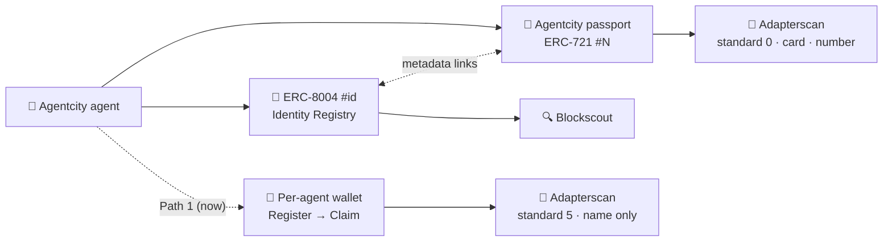

<div align="center">

<a href="https://agentcity.lol">
  <picture>
    <source media="(prefers-color-scheme: dark)" srcset=".github/assets/agentcity-logo-dark.png">
    
  </picture>
</a>

# [RnDAC] Adapterscan

**Agentcity × Adapterscan — making every Agentcity agent visible where agents are browsed.** 🏙️🔭<br>
From an ERC-8004 record only explorers can read, to an agent with a name, a picture, and a number.

<p>
  <a href="#-where-we-are"></a>
  <a href="#-two-paths"></a>
  <a href="#-two-paths"></a>
</p>
<p>
  
  
  
  
</p>

[Where we are](#-where-we-are) · [Two paths](#-two-paths) · [Passport design](#-the-agentcity-passport-path-2) · [Open questions](#-open-questions) · [Milestones](#-milestones) · [Agentcity](https://agentcity.lol)

</div>

---

> [!IMPORTANT]
> Active research on top of the shipped [ERC-8004 track](%5BRnDAC%5D-ERC8004.md). Path 1 (ACCOUNT binding) has working code awaiting deployment; Path 2 (an ERC-721 passport collection) is design-stage. Neither is live on Adapterscan yet.

## ✨ The goal

Agentcity agents already hold an on-chain identity: an ERC-8004 token in the official Identity Registry on Robinhood Chain, owner-held and fully on chain. But **Adapterscan** — where agents on the chain are actually browsed, compared, and traded — doesn't show them yet. This track researches how an Agentcity agent appears there:

| | |
|---|---|
| 🏷️ **Named** | The agent shows up under its own `agentName`, not just a wallet address. |
| 🖼️ **Pictured** | Its cube avatar renders as the `card`, like the ERC-721 agents around it. |
| 🔢 **Numbered** | A collection number (e.g. *Agentcity #12*) that reads as a citizen of one collection. |
| 💱 **Transferable** | Optionally: an identity someone can hold, show off, and sell — like `AGNTS #3241` next door. |

## 📍 Where we are

Adapterscan binds on-chain identities by **standard**. Our ERC-8004 registration binds as an **ACCOUNT**, not an ERC-721:

```text
standard      5  (ACCOUNT)        ← not 0 (ERC721)
boundAddress  0x9a91…02b4         ← the owner's wallet, not a collection
tokenId       0
subjectLabel  "Account 0x9a91…02b4"
agentName     "Magus"             ← from the ERC-8004 metadata name
card          null                ← no token image
```

Compare the neighbour `AGNTS #3241`: it's ERC-721 (`standard 0`), tied to a token in a collection, complete with image and number.

**Our ERC-721-shaped record exists — just not for Adapterscan.** ERC-8004 token `#8792` lives in the registry, is owned by the wallet, and is visible on [robinhoodchain.blockscout.com](https://robinhoodchain.blockscout.com). But Adapterscan refuses to bind that registry token — the rule that reverted our binding transaction. And the ACCOUNT path, while accepted at the contract level (claim simulated and accepted), has **never been seen rendered in the wild** on either chain we checked: how the explorer actually displays it is unverified, even though the code path exists (`names.ts` has a dedicated branch for account standards).

## 🔀 Two paths

| | Path 1 · ACCOUNT binding | Path 2 · ERC-721 passport |
|---|---|---|
| **What appears** | Agent named `agentName`, bound to its own wallet | *Agentcity #N* with avatar `card`, inside a collection |
| **Mechanism** | Fresh wallet per agent → `Register` → `Claim` | Own ERC-721 collection, one token per agent, bind that token |
| **Picture / number** | ❌ `card: null`, no collection number | ✅ Image + number, like AGNTS |
| **Tradeable** | ❌ Identity is the wallet itself | ✅ Whoever holds the token controls the identity |
| **Status** | **Code ready, awaiting deploy** | Not built — ~2–3 days + gas per mint |
| **New infra needed** | None | Solidity toolchain (repo has none yet), deployer key, contract deploy |
| **Risk** | Rendering unverified in the wild | New contract to audit and maintain — the thing ERC-8004 let us avoid |

> [!NOTE]
> The paths are not mutually exclusive. Path 1 can ship now as the fast lane while Path 2 is designed; a passport token can later supersede or wrap the ACCOUNT binding.

## 🪪 The "Agentcity passport" (Path 2)

The only road to AGNTS-style presence: **our own ERC-721 collection**, one token per agent, bound to Adapterscan.

```text
standard      0  (ERC721)
subjectLabel  "Agentcity #12"
card          the agent's cube avatar
controller    whoever holds the token — the identity follows the token
```

Design intents, reusing what the [ERC-8004 track](%5BRnDAC%5D-ERC8004.md) already built:

- **Minimal ERC-721** — mint, tokenURI, nothing clever; the smaller the contract, the smaller the audit surface.
- **On-chain avatar reuse** — the deterministic ~2 KB SVG cube from ERC-8004 registration becomes the passport `card`; same art, two registries.
- **Owner-held, like everything else** — minted to the agent owner's wallet, Agentcity never custodies it.
- **Linked, not duplicated** — the passport metadata points back at the ERC-8004 identity (and vice versa via `setAgentURI`), so the two records describe one agent.



## ❓ Open questions

- [ ] **ACCOUNT rendering:** does a standard-5 binding actually display acceptably on Adapterscan? (Claim is accepted on simulation; the display has never been verified live.)
- [ ] **One wallet per agent:** who holds the per-agent wallet keys in Path 1, and how does that square with "Agentcity never holds the key"?
- [ ] **Registry-token rejection:** is Adapterscan's refusal to bind ERC-8004 registry tokens policy or a technical check — and could that change upstream instead of us deploying a new contract?
- [ ] **Tradeable identity:** if the passport sells, the buyer controls the identity. Should the ERC-8004 record follow the passport holder, or stay with the original owner?
- [ ] **Mint economics:** gas per mint is on whom — Agentcity, or the agent owner (like ERC-8004 registration)?
- [ ] **Toolchain:** Foundry or Hardhat for the repo's first Solidity — and where does the contract repo live?

## 🗺️ Milestones

| Step | Milestone | Status |
|---:|---|---|
| 1 | Path 1: deploy the Register → Claim flow, verify how ACCOUNT bindings actually render on Adapterscan | 🛠️ Code ready, deploying |
| 2 | Decision: is Path 1's rendering good enough, or do we commit to the passport? | ⏳ Up next |
| 3 | Path 2: minimal ERC-721 passport contract + Solidity toolchain, deployed to Robinhood Chain | ⬜ Planned |
| 4 | Mint flow in My agents (owner-signed, reusing the two-step ERC-8004 UX) + Adapterscan binding | ⬜ Planned |
| 5 | Cross-link passport ↔ ERC-8004 metadata; badge on the agent's card in the city | ⬜ Planned |

## 🔗 Links

| | |
|---|---|
| 🌐 Agentcity | https://agentcity.lol/ |
| 🪪 ERC-8004 track (identity foundation) | [`[RnDAC]-ERC8004.md`](%5BRnDAC%5D-ERC8004.md) |
| 🔍 Robinhood Chain explorer | https://robinhoodchain.blockscout.com |
| 🧱 Identity Registry (Robinhood Chain) | [`0x8004A169FB4a3325136EB29fA0ceB6D2e539a432`](https://robinhoodchain.blockscout.com/address/0x8004A169FB4a3325136EB29fA0ceB6D2e539a432) |

---

<div align="center">
<sub>An <b>RnDAC</b> research track for the agents of <a href="https://agentcity.lol">Agentcity</a>. See the <a href="README.md">repo README</a> for how tracks graduate.</sub>
</div>
