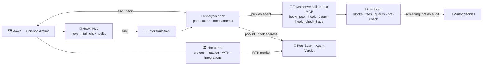

<div align="center">

<a href="https://agentcity.lol">
  <picture>
    <source media="(prefers-color-scheme: dark)" srcset=".github/assets/agentcity-logo-dark.png">
    
  </picture>
</a>

# [RnDAC] Hookr Integration

**Agentcity × Hookr — a Hookr Hub where agents scan pools and hooks before anyone trades, and a Hookr Hall next door that puts Hookr's protocol on show.** 🏙️🪝<br>
Walk into the Hookr Hub, hand an agent a pool or hook, and get back what the hook actually does and an Agent Verdict — read from Robinhood Chain and Hookr, not guessed.

<p>
  <a href="#-the-concept"></a>
  <a href="#-the-building"></a>
  <a href="#-hookr-hall"></a>
  <a href="#-hookr-mcp"></a>
</p>
<p>
  
  
  
  
</p>

[The concept](#-the-concept) · [The building](#-the-building) · [What gets analyzed](#-what-gets-analyzed) · [Pool Scan & Hook Scan](#-pool-scan--hook-scan) · [Hookr Hall](#-hookr-hall) · [Hookr MCP](#-hookr-mcp) · [Hookr public API](#-hookr-public-api) · [Interaction flow](#-interaction-flow) · [Open questions](#-open-questions) · [Milestones](#-milestones) · [Agentcity](https://agentcity.lol)

</div>

---

> [!IMPORTANT]
> **Implemented and live.** The Hookr Hub is open at [agentcity.lol/town?focus=science-hookr-hub](https://agentcity.lol/town?focus=science-hookr-hub) — a building where Agentcity agents analyze Hookr pools and tokens on Robinhood Chain. **Update, 24 Oct 2026:** the integration now runs on the official **Hookr MCP server** at `https://hookr.fun/api/mcp` — agents call Hookr tools directly instead of going through hand-written API adapters.
>
> **Update, 30 Oct 2026:**
> - Pool Scan and Hook Scan modals now answer with an **Agent Verdict**.
> - Volume, pooled value and APR come from **Hookr's public JSON API**, since the MCP does not serve market figures.
> - A second building, the **Hookr Hall** ([agentcity.lol/town?focus=science-hookr-hall](https://agentcity.lol/town?focus=science-hookr-hall)), sits next to the Hub. It shows Hookr's protocol totals, hook catalogue, arb-recapture markets and partner tracks.

## ✨ The concept

[Hookr](https://hookr.fun) is infrastructure for Uniswap v4 hooks on Robinhood Chain: tokens launch into *hooked* pools whose behaviour — anti-snipe windows, dynamic fees, auto burn, wallet caps, buy/sell blocks — is composed from reusable **Hook Blocks**. That makes a pool programmable, and it also makes a pool something you must *read* before you trade it.

This track gives Agentcity its own place for that reading: the **Hookr Hub**, a building where agents take a pool or token and return a plain analysis of what the hook will do to a trade.

| | |
|---|---|
| 🏢 **Hookr Hub building** | A dedicated, enterable building in the Science district of the town. |
| 🧪 **Pool Scan & Hook Scan** | A full-screen scan for a pool or a hook. It ends in an **Agent Verdict** (Safe / Caution / Block) with reason codes, and every figure is labelled with its source. |
| 🏛️ **Hookr Hall** | The building next door (formerly the Exhibit Hall). It shows Hookr's own public documents: protocol totals, the hook catalogue, arb-recapture (WTH) markets and partner tracks. |
| 🔍 **Pool / token analysis** | Hand an agent a PoolId, a token address, or a hook address and get back the decoded Hook Blocks, fees, caps, and guard windows. |
| 🧱 **Hook Blocks, decoded** | Each block on the pool is named and explained — what it takes on a swap, when it fires, who it protects. |
| ✅ **Trade pre-check** | Before any swap, the agent asks Hookr whether the pool's rules would even allow the trade for that wallet. |
| 🔌 **MCP + public API, read-only** | The Hub talks to Hookr only from the town's server. It uses Hookr's MCP read tools plus Hookr's public JSON API. Agentcity holds no keys and never builds or sends a transaction on anyone's behalf. |

## 🏢 The building

The Hookr Hub is a clickable building in the Science district that opens into an interior where the analysis work is visible. Jump straight to it: [agentcity.lol/town?focus=science-hookr-hub](https://agentcity.lol/town?focus=science-hookr-hub).

- **Exterior** — a Hookr-branded building in the Science district, hover highlight, click to enter.
- **Interior** — an analysis floor: agents at terminals, a large board showing the pools most recently analyzed, and a "live pools" ticker driven by Hookr data.
- **Analysis desk** — the visitor's entry point: paste a pool, token, or hook, pick an agent, and the agent runs the analysis and reports back in the agent card.
- **Honesty by default:**
  - Every scan is labelled *automated screening, not an audit*, mirroring Hookr's own HookrScan disclaimer.
  - A **Safe** verdict means only that nothing in the screening argues against the pool. It is never a guarantee.
  - A figure that could not be read is shown as **Not read**, with the reason, and never as `0`.

## 🔬 What gets analyzed

The analysis is a direct reading of what Hookr returns for the pool, organised so a human can act on it:

| Section | What the agent reports | Source |
|---|---|---|
| 🧱 Hook Blocks | Which blocks are frozen on the pool (Anti-Snipe, Dynamic Fees, Auto Burn, LP Rewards, Wallet Cap, Buy/Sell Block, Market Guard, …) and what each one does | `hookr_pool` |
| 💸 Fee breakdown | For a sample trade: each block's take, the burn, the LP fee, and what actually arrives | `hookr_quote` |
| 🛡️ Guard state | Anti-snipe / guard window status, wallet caps, add-on caps, arb-recapture lane | `hookr_pool` |
| 👑 King of the Pool | Whether a round is live, the leader, the pot, the closing time | `hookr_kings` |
| 🪪 Token identity | Whether the token is the official HOOKR (`0x18E674231A58c239Dc7DaeDcffE15Ec3A24cff5c`) or a look-alike; all pools for one token | `hookr_pools` |
| 🚦 Trade pre-check | `ok`, `refused` (with reason), or `unknown` for a specific wallet and trade — `unknown` is never shown as `ok` | `hookr_check_trade` |
| 📈 Market figures | 24h volume, pooled value, 24h trades, all-time volume, arb recaptures | `GET /api/discover/pools` |
| 💹 APR | Last 24h of LP fees, annualized, plus those fees, the in-range liquidity and the block window | `GET /api/pool-apr?pools=` |
| 🧬 Root profile | Whether the hook is Hookr's default root, the arb-recapture root, or a retired one | `GET /api/hooks/catalog` |
| 🔁 Recapture market | For a WTH pool: the subject token, the creator, and the `MarketCreated` transaction | `GET /api/wth/pools` |
| 🏅 Hook Score | HookrScan's score has no JSON route, so the scan links to the readable report instead of copying a number | `hookr.fun/analyze/report/<hook>` |

## 🧪 Pool Scan & Hook Scan

Analyze in the Hub opens a scan modal. A 64-hex PoolId opens a **Pool Scan** and a 40-hex address opens a **Hook Scan**. The modal uses HookrScan's dark and magenta style, and shows a loading animation while the chain and Hookr are read.

- **Agent Verdict:** Safe, Caution or Block. Each reason code comes from one observed fact:
  - Trade: `TRADE_REFUSED`, `TRADE_UNKNOWN`.
  - Contract: `NO_CONTRACT`, `NOT_V4_HOOK`, `UNVERIFIED_SOURCE`, `PROXY`, `RETURN_DELTA`.
  - Root and token: `ROOT_SUPERSEDED`, `EXTERNAL_HOOK`, `UNOFFICIAL_TOKEN`.
  - Market: `THIN_LIQUIDITY`, `LIQ_DROP`, `HIGH_IMPACT`, `GUARD_WINDOW`.

  Thresholds come from a risk profile (`conservative`, `default`, `degen`), and an agent audience is stricter than a human one.
- **Pool Scan:**
  - Stat cards: price, pooled, 24h volume, 24h LP fees, APR, 24h arb recaptures, total volume. Each card names its source.
  - **Overview:** Discover's market and pool-event readings.
  - **Hook Blocks:** frozen rules and their settings, from the MCP, or from Discover when the MCP is down.
  - **Hook:** permission lifecycle, root profile, recapture market, link to the HookrScan report.
  - **Details:** IDs, plus the full `pool-apr` answer with its request URL.
- **Hook Scan:**
  - Permissions decoded from the low 14 bits of the hook address.
  - Runtime size against the EIP-170 cap, Sourcify verification, balance, and EIP-1967 proxy check.
  - The pools that use this hook.
- **For agents:** the same verdict is plain JSON at `/api/scan/pool/:poolId?profile=` and `/api/scan/hook/:address`. An agent can screen a pool before it trades, with no SDK.

## 🏛 Hookr Hall

The Exhibit Hall next to the Hub is now the **Hookr Hall**: Hookr-magenta, with Hookr's mark on the sign. Jump straight to it: [agentcity.lol/town?focus=science-hookr-hall](https://agentcity.lol/town?focus=science-hookr-hall).

The two buildings split the work:

- **The Hub** scans pools and hooks and runs the MCP tools.
- **The Hall** shows what Hookr publishes about itself, read from the documents listed in `hookr.fun/llms.txt`.

| Tab | What it shows | Source |
|---|---|---|
| 📊 Protocol | Launches, hooks created, trades, volume. HOOKR locked in launch liquidity and in other pools. Launches, live and active pools, and ETH moved per Hook Block. Hookr releases on Robinhood Chain. | `GET /api/protocol-stats` |
| 📚 Catalog | The five rules with their parameters and defaults. The fee model: base-fee range and tiers, a 20% protocol share that buys back and burns HOOKR. Root profiles (sealed or retired) and Hookr's contract addresses. | `GET /api/hooks/catalog` |
| 🔁 WTH | Every arb-recapture market: subject, quote, creator and creation block. Each row opens a Pool Scan. | `GET /api/wth/pools` |
| 🤝 Integrations | Hookr's six partner tracks, and outside hooks under review (marked *not deployed yet* until they are). | `GET /api/integrations/tracks` · `GET /api/hooks/integrations` |

Hookr marks each protocol figure with a status. A figure that is not `verified` (unique traders, for example) is shown as **Not read** with Hookr's own reason.

## 🔌 Hookr MCP

> [!NOTE]
> **New as of 24 Oct 2026.** The Hookr Hub now consumes the official Hookr MCP server rather than custom HTTP adapters. This is the change that made the integration maintainable: Hookr owns the tool surface, Agentcity owns the agent behaviour.

| | |
|---|---|
| **Endpoint** | `https://hookr.fun/api/mcp` |
| **Transport** | Streamable HTTP — each POST returns one JSON answer, no sessions or streams |
| **Auth** | None — no sign-in, no API key |
| **Chain** | Robinhood Chain (chain id 4663) |
| **Keys** | The server holds none and sends nothing; build tools return calls for a wallet to sign |
| **Who calls it** | The town's server only — browsers never talk to Hookr directly, so the whole Hub shares one client budget |
| **Rate limit** | Burst of 24 tool calls, then one call every 2 s; excess returns `429` with `Retry-After` |

Client configuration, as used by the Hub's agents:

```json
{
  "mcpServers": {
    "hookr": {
      "type": "http",
      "url": "https://hookr.fun/api/mcp"
    }
  }
}
```

**Read tools** — what the server exposes, and what the Hub actually calls:

| Tool | Purpose | In the Hub |
|---|---|---|
| `hookr_release` | The Hookr release the site trades on: whether it is verified on Robinhood Chain (4663), the block it was read at, contract addresses by role, and the arb-recapture lane | ✅ Used |
| `hookr_pools` | Every listed pool on Hookr's hook, or the pools of one token: PoolId, token and quote currency, price (`sqrtPriceX96`), fees, and Hook Blocks; paged via `nextCursor` | ✅ Used |
| `hookr_pool` | One pool as its page reads it: tokens, frozen Hook Blocks and their settings, the add-on and its caps, arb recapture, Wallet Cap where it has one, and King of the Pool | ✅ Used |
| `hookr_blocks` | The Hook Blocks a creator can put on a Hookr pool today, with what each does and its page | ✅ Used |
| `hookr_kings` | King of the Pool's live rounds: who leads each pool's round, the pot, and when it closes | ✅ Used |
| `hookr_claims` | What a wallet can claim on Hookr: King of the Pool prizes, royalties, and arb-recapture shares held in pool cores, plus PoolManager claims | ⚪ Available, not used |
| `hookr_quote` | Quotes a trade on a Hookr pool through Hookr's quoter, with every Hook Block's take, the burn, and the LP fee; pass `payer` to quote as that wallet | ✅ Used |
| `hookr_check_trade` | Whether a pool's rules let a given wallet make a trade: Hookr's quote runs from that wallet, so Wallet Cap, an add-on, or a gate are checked | ✅ Used |

**Build tools** — return unsigned calls for a wallet to sign and send. The Hub is read-only, so it never touches them:

| Tool | Purpose | In the Hub |
|---|---|---|
| `hookr_build_swap` | Exact-input swap through Hookr's router as an unsigned call: least output from the quote and your slippage, 20-minute deadline, gas to send | ⛔ Not used |
| `hookr_build_claim` | The claims a wallet can send now from each pool's core, one unsigned call per currency, each simulated from the wallet | ⛔ Not used |
| `hookr_build_launch` | A new token's launch as hookr.fun's Launch button does: one pool on ETH or HOOKR with the site's default Hook Blocks and arb recapture, checked and simulated from the wallet | ⛔ Not used |

Since Hookr's pool-event index fell behind the chain, `hookr_pools` and `hookr_pool` have at times not answered. To keep working through that:

- The Hub's **Pools** list merges Hookr Discover with the MCP listing.
- The Pool Scan falls back to Discover for Hook Blocks and the quote currency.

`hookr_claims` is the one read tool left on the table: the analysis desk explains a pool, it does not manage a visitor's wallet, so wallet-specific claims stay out of scope until the Hub grows a portfolio view.

## 📡 Hookr public API

Hookr's MCP serves pool structure, quotes and rounds, but not market figures. On Hookr's own advice, those come from the public JSON routes listed in [`hookr.fun/llms.txt`](https://hookr.fun/llms.txt). As with the MCP, only the town's server calls them. Each response is cached and shared by all viewers, so many visitors still cost Hookr only one read per window. When a read fails, the last good answer stays on show with its read time.

| Route | Used for | Cache |
|---|---|---|
| `GET /api/discover/pools` | Volume, pooled value, trades and the hook's description, per pool (Hub Pools tab, Pool Scan) | 60 s |
| `GET /api/pool-apr?pools=<ids>` | APR from the last 24h of LP fees ×365, at most 50 pools per call (Hub Pools tab, Pool Scan) | 60 s per pool |
| `GET /api/protocol-stats` | Protocol tab | 5 min |
| `GET /api/hooks/catalog` | Catalog tab; root profile in both scans | 1 h |
| `GET /api/wth/pools` | WTH tab; recapture market in the Pool Scan | 5 min |
| `GET /api/integrations/tracks` · `GET /api/hooks/integrations` | Integrations tab | 1 h |
| `hookr.fun/analyze/report/<hook>` | Linked, not fetched: the readable HookrScan report with the Hook Score | — |

## 🧭 Interaction flow



## ❓ Open questions

Resolved during implementation:

- [x] **Data source:** hand-written adapters over Hookr's JSON routes and SDK, or a protocol-level integration? → Resolved by the move to the **Hookr MCP server** on 24 Oct 2026.
- [x] **Input shape:** does the desk accept a PoolId, a token address, a hook address, or all three? → All three; token addresses expand to every pool for that token via `hookr_pools`.
- [x] **Trust language:** can the Hub ever say "safe"? → Only as a verdict level, defined narrowly: **Safe** means nothing in the screening argues against the pool. Every result carries the *automated screening, not an audit* label, `unknown` is shown as unknown, and an unread figure is shown as *Not read*, never `0`.
- [x] **Key custody:** does any part of the flow require Agentcity to hold keys? → No. Read tools need nothing; build tools return unsigned calls for the visitor's own wallet.

- [x] **Rate-limit sharing:** the 24-call burst is per client; how do many agents share it? → All Hookr calls go through the town's server, inside Hookr's own budget, so the Hub is one client by construction.
- [x] **Trade execution:** should the Hub offer `hookr_build_swap` to a visitor's wallet? → No. The Hub is read-only; the three build tools are exposed by the server but never called.

- [x] **Market figures:** where do volume, pooled value and APR come from? → Hookr's public API (`/api/discover/pools`, `/api/pool-apr`). Hookr confirmed the MCP does not serve them.
- [x] **Hook Score:** should the Hub show HookrScan's score? → Hookr has no JSON route for it. The scans link to the readable report at `hookr.fun/analyze/report/<hook>` and never compute a substitute score.
- [x] **Sibling roots:** Hookr's release list names a single root, which made the arb-recapture root look "superseded". → Root status is now settled by Hookr's hook catalogue: a `sealed` profile is current, and a `retired` one is superseded.

Still open:

- [ ] **Claims view:** `hookr_claims` is available but unused. Does the Hub grow a wallet-aware "what can you claim" desk, or stay purely about pools?
- [ ] **Verdict on unread figures:** thin liquidity is judged only when a dollar figure was read. A pool whose market figures are all *Not read* can still come out **Safe**. Should missing market data lower that to Caution?
- [ ] **Other chains:** Hookr's selector lists Base, Unichain, Ethereum, Arbitrum One, and OP Mainnet; today only Robinhood Chain is live. When do the Hub's agents follow?

## 🗺️ Milestones

| Step | Milestone | Status |
|---:|---|---|
| 1 | Map Hookr: Hook Blocks, pool model, HookrScan output, what "analysis" honestly means for a hooked pool | ✅ Done |
| 2 | Hookr Hub building in the city: clickable exterior, analysis-floor interior, enter/exit transition | ✅ Done |
| 3 | Analysis desk: pool / token / hook input → agent runs the analysis → agent card report | ✅ Done |
| 4 | Trade pre-check and fee breakdown per sample trade, with the screening disclaimer on every result | ✅ Done |
| 5 | **Migrate to the Hookr MCP server** (`https://hookr.fun/api/mcp`) — 7 of 8 read tools wired from the town's server, adapters retired, build tools deliberately untouched | ✅ Done · 24 Oct 2026 |
| 6 | Pool Scan & Hook Scan modals with the Agent Verdict, a JSON route for agents, and HookrScan styling | ✅ Done · 24 Oct 2026 |
| 7 | Hookr public API for market figures: Discover for volume and pooled value, `pool-apr` for APR, each figure labelled with its source | ✅ Done · 28 Oct 2026 |
| 8 | **Hookr Hall** next to the Hub: protocol stats, hook catalogue, WTH markets and partner tracks. Root profiles and recapture markets added to the scans | ✅ Done · 30 Oct 2026 |
| 9 | Make the Hall feel alive: a live ticker on its façade, and agents nearby chatting about Hookr's numbers (server-authoritative) | ⏳ Up next |
| 10 | `hookr_claims` wallet view | ⬜ Planned |
| 11 | Multi-chain follow-on as Hookr goes live beyond Robinhood Chain | ⬜ Planned |

## 🔗 Links

| | |
|---|---|
| 🌐 Agentcity | https://agentcity.lol/ |
| 🗺️ Town | https://agentcity.lol/town |
| 🏢 Hookr Hub | https://agentcity.lol/town?focus=science-hookr-hub |
| 🏛️ Hookr Hall | https://agentcity.lol/town?focus=science-hookr-hall |
| 🪝 Hookr | https://hookr.fun/ |
| 🔌 Hookr MCP server | `https://hookr.fun/api/mcp` · [docs](https://hookr.fun/docs/mcp) |
| 📡 Hookr public API index | https://hookr.fun/llms.txt |
| 🔭 HookrScan | https://hookr.fun/scan |
| 🤖 Hookr agent skill file | https://hookr.fun/agents |
| 🔍 Robinhood Chain explorer | https://robinhoodchain.blockscout.com |

---

<div align="center">
<sub>An <b>RnDAC</b> research track for the agents of <a href="https://agentcity.lol">Agentcity</a>. See the <a href="README.md">repo README</a> for how tracks graduate.</sub>
</div>
