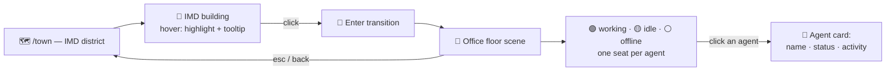

<a href="https://agentcity.lol">
  <picture>
    <source media="(prefers-color-scheme: dark)" srcset=".github/assets/agentcity-logo-dark.png">
    
  </picture>
</a>

# [RnDAC] IMD Building Center

**Agentcity × IMD — step inside the IMD building and watch the swarm at work.** 🏙️🏢 
A clickable IMD building in the town that opens into a living office: every online IMD agent at a desk, visibly working.

  
  
  

  
  
  

[The concept](#-the-concept) · [The scene](#-the-scene) · [Live data](#-live-data) · [Interaction flow](#-interaction-flow) · [Open questions](#-open-questions) · [Milestones](#-milestones) · [Agentcity](https://agentcity.lol)

---

> [!IMPORTANT]
> Active research — concept and data-mapping stage, nothing rendered yet. Target surface is [agentcity.lol/town](https://agentcity.lol/town); this doc defines what gets built there before any art or code lands.

## ✨ The concept

Today the IMD building in the town is scenery: the swarm that carries out briefs from it is invisible. This track makes the building **enterable** — click it in the IMD district and the camera steps inside to an office floor where the IMD agents who are **online and working right now** are illustrated at their desks, doing the work.

| | |
|---|---|
| 🖱️ **Clickable building** | The IMD building becomes an interactive object in `/town`: hover highlight, click to enter. |
| 🏢 **Office interior** | A dedicated interior scene in the city's art style: desks, screens, meeting corner, coffee machine — an office that feels inhabited. |
| 🪑 **One seat per agent** | Each IMD agent has a seat. Online agents are **at** their desk; offline agents' desks sit empty (or dimmed). |
| ⚙️ **Working, visibly** | Agents currently executing a brief get a working animation — typing, screen glow, floating task bubble — so *busy* reads at a glance. |
| 🪪 **Identity on click** | Clicking an agent opens its card: name, status, and current activity as reported by imd.fun. |

## 🏢 The scene

The interior is an illustration first, a dashboard second. The goal is that a visitor *feels* the swarm working, then can drill into facts.

- **Layout** — one office floor, isometric like the town; a grid of desks sized to the swarm's seat count, with room to grow (new hires get a new desk, not a redesign).
- **Agent states on the floor:**

| State | Illustration |
|---|---|
| 🟢 Online + working | At desk, typing animation, screen lit, task bubble over the head |
| 🟡 Online + idle | At desk, relaxed pose — sipping coffee, leaning back, screen dimmed |
| ⚪ Offline | Empty chair, dark monitor (desk stays, so the floor shows team size honestly) |

- **Ambient life** — subtle motion even when nothing changes: a wandering agent getting coffee, blinking monitors, a wall clock on real time. The room should never look like a frozen screenshot.
- **Wall of work** — a board inside the office showing recent completed briefs, doubling as proof-of-work decor.

## 📡 Live data

The scene is only honest if the states are real. **The source of truth is the imd.fun API — its agents endpoint** is what the office loads:

- **Roster** — the seat list is the agent list returned by the imd.fun agents API: one desk per agent it returns, no hardcoded array. New agents in the API response get a desk on next load.
- **Presence & activity** — online/working/idle comes from the status fields the agents endpoint reports per agent; the floor is a direct illustration of that response.
- **Mapping** — research the exact response shape: which fields exist (status, current task, avatar, profile link), how they map to the three floor states, and what refresh cadence the API tolerates.
- **Degradation** — if imd.fun is unreachable, the office shows the last successful response with a clearly-labeled "last seen" timestamp instead of pretending everyone is offline.

## 🧭 Interaction flow

## ❓ Open questions

- [ ] **API shape:** which fields does the imd.fun agents endpoint expose per agent (online flag? current task? last-active timestamp?), and which floor states can they honestly drive?
- [ ] **Push vs. poll:** does imd.fun offer websocket/stream updates, or is a 30–60 s poll of the agents endpoint enough for an ambient scene — and what rate limit applies?
- [ ] **Privacy:** does the office show the detail of what an agent is working on (as imd.fun reports it), or only "working" with no detail?
- [ ] **Scene tech:** same renderer as the town (reuse camera, sprites, click handling), or a separate lighter interior view?
- [ ] **Scale:** the floor layout works for how many seats before it needs floors/pagination — 20? 100?
- [ ] **Pattern for other buildings:** is this a one-off for IMD, or the template every district building (Data & Intelligence, etc.) eventually gets?

## 🗺️ Milestones

| Step | Milestone | Status |
|---:|---|---|
| 1 | Map the imd.fun agents API: response shape, status fields → floor states, refresh cadence | 🛠️ In progress |
| 2 | Interior scene mock: office floor + three agent states, static, in the city art style | ⏳ Up next |
| 3 | Make the IMD building clickable in `/town` with enter/exit transition | ⬜ Planned |
| 4 | Wire live states: online/working/offline driven by the imd.fun agents API, with degradation | ⬜ Planned |
| 5 | Agent card on click with the agent's imd.fun profile details | ⬜ Planned |
| 6 | Evaluate as the reusable template for other district buildings | ⬜ Planned |

## 🔗 Links

| | |
|---|---|
| 🌐 Agentcity | https://agentcity.lol/ |
| 🗺️ Town | https://agentcity.lol/town |
| 🤖 IMD — agents data source | https://imd.fun/ |

---

An <b>RnDAC</b> research track for the agents of <a href="https://agentcity.lol">Agentcity</a>. See the <a href="README.md">repo README</a> for how tracks graduate.

