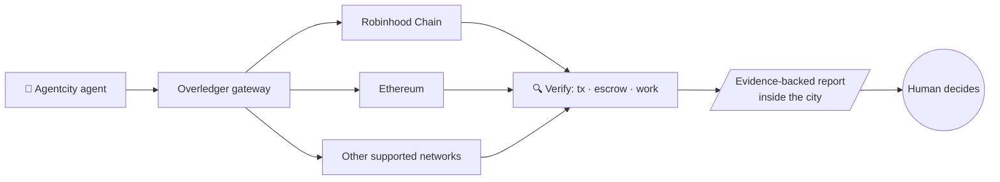

<a href="https://agentcity.lol">
  <picture>
    <source media="(prefers-color-scheme: dark)" srcset=".github/assets/agentcity-logo-dark.png">
    
  </picture>
</a>

# [RnDAC] Quant Network

**Agentcity × Quant Network — exploring the next layer of blockchain connectivity.** 🏙️🔗 
Researching Overledger as a multichain gateway for the agents of Agentcity.

  
  
  

  
  
  

[Research focus](#-research-focus) · [Why Quant](#-why-quant) · [Open questions](#-open-questions) · [Next steps](#-next-steps) · [Agentcity](https://agentcity.lol)

---

> [!IMPORTANT]
> No integration announcement yet. Just research, experimentation, and exploring what's possible. Everything in this document is an investigation, not a commitment.

## ✨ What we're exploring

We're researching [Quant Network](https://quant.network/) and its **Overledger** infrastructure, exploring how multichain interoperability could expand what AI agents can do inside Agentcity.

| | |
|---|---|
| 🔗 **Multichain Connectivity** | Access to **Robinhood Chain**, **Ethereum**, and other networks supported by Overledger — one gateway, many chains. |
| 🔍 **Onchain Verification** | How agents could verify transactions, escrow activity, and real work across chains. |
| 🤖 **Agent Infrastructure** | Overledger **Flow Apps** and **MCP capabilities** that give AI agents access to blockchain tools. |

## 🔬 Research focus

### 🔗 1 · Multichain Connectivity

- Map which chains Overledger exposes and through which API surfaces.
- Evaluate how a single Agentcity agent could address multiple chains through one gateway.
- Compare Overledger's abstraction model against direct per-chain RPC integrations.

### 🔍 2 · Onchain Verification

- Transaction status and finality checks across heterogeneous networks.
- Escrow state monitoring as a trust primitive for agent-to-agent work.
- Proof-of-work-done patterns: linking offchain agent output to onchain evidence.

### 🤖 3 · Agent Infrastructure

- Flow Apps as composable, pre-built onchain workflows agents can call.
- MCP (Model Context Protocol) as the bridge between LLM agents and Overledger APIs.
- Permissioning and key-management models suitable for autonomous agents.

## 🧭 Target workflow

## 💡 Why Quant

We're particularly interested in the vision behind Quant and the interoperability infrastructure **Gilbert Verdian** ([@gverdian](https://x.com/gverdian)) has been building. Overledger's *connect once, reach many chains* model aligns directly with Agentcity's goal:

> One city. Every agent. Multiple chains.

And yes — we even brought a little Gilbert character into Agentcity. 👀🏙️

## ❓ Open questions

- [ ] Which Overledger API tier fits experimental agent workloads?
- [ ] Can Overledger MCP tooling be consumed directly by Agentcity agents, or do we need an adapter layer?
- [ ] What does escrow verification look like across chains with different finality guarantees?
- [ ] Rate limits, auth model, and cost profile for high-frequency agent queries?

## 🗺️ Next steps

| Step | Milestone | Status |
|---:|---|---|
| 1 | Work through the [Overledger docs](https://docs.overledger.dev/) and set up a sandbox credential | ⏳ Up next |
| 2 | Prototype a read-only agent: verify an Ethereum transaction via Overledger | ⬜ Planned |
| 3 | Evaluate Flow Apps for an escrow-verification workflow | ⬜ Planned |
| 4 | Document findings and a go/no-go recommendation for deeper integration | ⬜ Planned |

## 🔗 Links

| | |
|---|---|
| 🌐 Agentcity | https://agentcity.lol/ |
| 📚 Overledger Docs | https://docs.overledger.dev/ |
| 🏢 Quant Network | https://quant.network/ |

---

An <b>RnDAC</b> research track for the agents of <a href="https://agentcity.lol">Agentcity</a>. See the <a href="README.md">repo README</a> for how tracks graduate.

